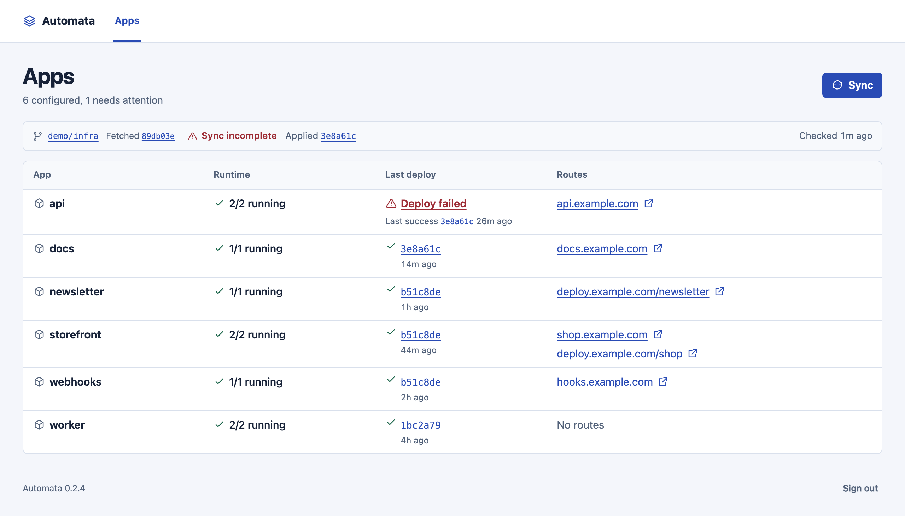

# Automata

A small self-hosted PaaS managed from a GitHub repo. Push a change and Automata deploys it on your server.



- Run Docker images, Compose apps, or projects with a Dockerfile. Keep the source in your infra repo or point to another GitHub repo.
- Publish apps through Cloudflare Tunnel and back up Docker volumes to Cloudflare R2.
- See deploy status and per-container logs. Automata updates `:latest` images and rolls back failed deploys.

## Install

On a Linux server with Docker and the Compose plugin:

```sh
curl -fsSL https://raw.githubusercontent.com/bgwastu/automata/main/install.sh | sudo sh
sudoedit /etc/automata/env
```

Set `INFRA_REPO` to `owner/repo` and choose an `AUTOMATA_PASSWORD` for encrypting secrets. Set `GITHUB_TOKEN` if Automata needs to read private repos.

## Add an app

Put the server settings in `automata.yml` at the root of your infra repo. Set a domain and add your encrypted Cloudflare token to publish the dashboard.

```yaml
domain: deploy.example.com
encrypted_env:
  CLOUDFLARE_API_TOKEN: <encrypted token>
```

Run `sudo automata encrypt` on the server and pass the secret on stdin. Use its output as the value under `encrypted_env`. Protect the dashboard with Cloudflare Access on its domain or add an encrypted `DASHBOARD_PASSWORD` to the root config.

The Cloudflare token needs **Cloudflare Tunnel Edit**, **Zone Read**, **DNS Edit**, **Access: Apps and Policies Read**, and **Access: Organizations, Identity Providers, and Groups Read**. Add **Workers R2 Storage Edit** if you use backups.

Each folder under `apps/` is an app. Add a `compose.yaml` or `Dockerfile`, or run an existing image with just `apps/whoami/automata.yml`:

```yaml
image: traefik/whoami:latest
path: /whoami
port: 80
```

Use `path` to serve an app on the dashboard’s domain, or use `domains` and point each hostname’s CNAME at the tunnel. Enable volume backups with `backup.bucket` in the root config and `backup: true` for each app you want backed up.

Push the repo, then start Automata:

```sh
sudo systemctl start automata
```
